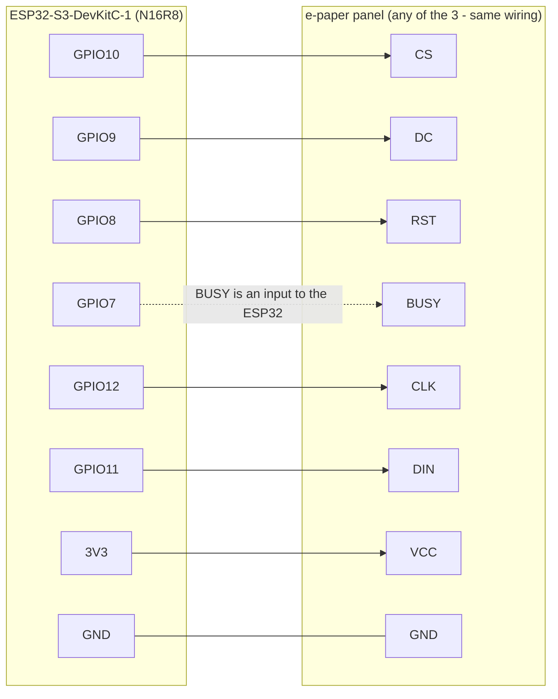

# Hardware setup and wiring

**Status: a wiring plan, not a physically-verified build.** There is no
board or panel in the environment this was written in - every GPIO choice
below is cross-checked against official documentation and community
references (see Sources), not tested with a multimeter or a working panel.
Treat this as what to wire, and update it once you've actually done so and
confirmed it works (see the checklist at the bottom).

## Bill of materials

| Part | Status | Notes |
|---|---|---|
| ESP32-S3-WROOM-1-N16R8 dev board | **Confirmed** | 16MB flash / 8MB octal PSRAM, DevKitC-1 form factor. Verified against an ARCELI clone (amazon.nl/dp/B0FQBYLL6S) - any board with this exact module/form-factor combination works identically; this is what `platformio.ini` already targets. |
| e-paper panel | **3 supported, none chosen** (README Phase 0b) | Panel choice is a firmware **build-time** decision (a PlatformIO environment - see README's [Web setup/debug portal](../README.md#web-setupdebug-portal) for why it isn't a *functional* runtime/web-GUI setting), not a wiring-only one - each panel needs different compiled code. All three below build cleanly; none is hardware-confirmed. Wiring is identical across all three (see the GPIO table below) - only the driver differs. The setup portal's web page does show which panel driver is actually compiled into the currently-flashed firmware (read-only "Display panel" field) - see `src/setup_portal.cpp`'s `activePanelName()`. |
| USB-C cable | Assumed | ESP32-S3-DevKitC-1's native USB port is USB-C on the official board and most clones; confirm on yours. |
| Battery + charge circuit | **Not decided** | README calls this project "battery-capable" by design (deep sleep between wake cycles) but no specific battery/charging hardware has been chosen yet - out of scope for this doc until it is. |

### The 3 supported panels

| Panel | Colors | Refresh | Build environment | Driver |
|---|---|---|---|---|
| Waveshare 7.3" ACeP | 7-color | ~28-40s | `esp32-s3-devkitc-1-panel-acep730` | `GxEPD2_730c_ACeP_730` (GxEPD2 library) |
| Waveshare 7.5" e-Paper V2 | Monochrome | ~1.2s full / ~0.45s partial | `esp32-s3-devkitc-1-panel-mono-v2` | `GxEPD2_750_GDEY075T7` (GxEPD2 library) |
| Pimoroni Inky Impression 7.3" | 7-color | ~41s (measured by Pimoroni) | `esp32-s3-devkitc-1-panel-inky` | `InkyImpressionDriver` - **hand-written**, no GxEPD2 support exists for this controller; see below |

The mono panel's refresh speed is a real, meaningful tradeoff (README Key
risk #1: e-paper refresh time, not WiFi, dominates the power budget) -
switching to it is likely the single biggest lever available for battery
life, at the cost of losing color entirely (icons/UI still render, just
thresholded to black/white - see `dither::floydSteinbergMono()`).

## ESP32-S3 GPIO assignments (confirmed safe)

From `include/config.h`'s `pins` namespace. Checked against Espressif's
ESP32-S3-DevKitC-1 pinout - see that file's comment for the full list of
reserved pins this avoids (flash/PSRAM SPI including the extra GPIO 33-37
octal-PSRAM reservation N16R8 boards have, native USB, strapping pins,
UART0, the onboard RGB LED).

| Signal | ESP32-S3 GPIO | Direction (ESP32-S3 side) |
|---|---|---|
| EPD CS (chip select) | 10 | out |
| EPD DC (data/command) | 9 | out |
| EPD RST (reset) | 8 | out |
| EPD BUSY | 7 | in |
| EPD SCK (SPI clock) | 12 | out |
| EPD MOSI / DIN (SPI data) | 11 | out |
| EPD MISO | not connected | - (e-paper is write-only; `SPI.begin()` just wants a value, see `pins::kEpdMiso = -1`) |

Setup-portal trigger: GPIO 0, the onboard **BOOT button** - no wiring needed,
it's built into the dev board itself. Hold it at power-on/reset to force
setup mode; see README's [Web setup/debug portal](../README.md#web-setupdebug-portal).

Power: **3.3V logic** on both sides - the ESP32-S3 is natively 3.3V and
e-paper panels are too (per GxEPD2's own wiring guidance: "panels are for
3.3V supply and 3.3V data lines; never connect data lines directly to 5V").
No level shifter needed. Power the panel's VCC from the dev board's 3V3 pin
and share GND.

## Panel side (all three)

The signal names above are the standard e-paper SPI convention GxEPD2 uses
throughout (confirmed via its own `ConnectingHardware.md`): **VCC, GND,
DIN, CLK, CS, DC, RST, BUSY** - and the Inky Impression's own raw-SPI driver
(`inky_ac073tc1a.py`) uses the same four control signals plus SPI, so this
table and diagram apply to all three panels identically. What's **not**
confirmed here is the *physical connector pin order* on any of these
panels' breakout boards - Waveshare's own wiki was unreachable while
researching this (blocked the fetch), and connector pinout can vary between
a panel's HAT version (40-pin Raspberry Pi header, needs a breakout since
we're not using a Pi header) and any raw/bare driver-board version. **Wire
by matching the label silkscreened on the panel's own connector to the
signal name in the table above - never by pin position/order** - and
confirm against the panel's actual manual once it's in hand.

## Inky Impression specifically: extra risk

The other two panels go through GxEPD2, a mature, widely-used library.
`InkyImpressionDriver` does not - it's a from-scratch port of Pimoroni's
Python driver (see `src/display/inky_impression_driver.cpp`'s top comment
and docs/attribution.md), since no C/C++ driver exists for the AC073TC1A
controller. It's the least-verified of the three by a wide margin. Highest
risk specifically: **BUSY pin polarity is inferred, not confirmed** - the
port assumes BUSY reads LOW while the panel is busy and HIGH when ready
(based on how Pimoroni's driver configures a rising-edge wait on that
line), but if a real panel is wired backwards from that assumption, the
driver will either hang for the full timeout on every operation (safe, if
annoying) or - worse - send new commands while the panel is still mid-
refresh. Before trusting this driver with a real panel: verify BUSY's idle
and active levels directly (e.g. log `digitalRead()` on that pin right
after power-on/reset) rather than assuming the port got it right.

## What still needs a real board to confirm

- [ ] Panel connector pin *order* (label-match wiring above, then verify
      with a continuity check before powering on).
- [ ] Physical continuity of every GPIO trace listed above.
- [ ] Phase 0a exit criterion: board boots, prints over serial
      (`tools/run.ps1` / `tools/run.sh`, no panel needed for this step).
- [ ] Phase 0b exit criterion: a solid color (or, for the mono panel, a
      solid black/white fill) renders correctly on the physical panel (see
      README's phased build sequence).
- [ ] `InkyImpressionDriver`'s BUSY polarity (see above) - the single
      highest-risk unconfirmed detail across all three drivers.
- [ ] Whether the ACeP panels need a `PWR`/enable pin beyond VCC - some
      Waveshare driver boards have one; unconfirmed here.
- [ ] Battery/charging hardware - not yet chosen at all.

## Sources

- [Espressif ESP32-S3-DevKitC-1 v1.0 user guide](https://docs.espressif.com/projects/esp-dev-kits/en/latest/esp32s3/esp32-s3-devkitc-1/user_guide_v1.0.html) - pin header layout, octal-PSRAM GPIO 35-37 reservation.
- [esp32.co.uk ESP32-S3 DevKitC-1 safe-GPIO guide](https://esp32.co.uk/esp32-s3-devkitc-1-pinout-diagram-safe-gpios-2026/) - strapping/USB/safe-pin cross-check.
- [GxEPD2's ConnectingHardware.md](https://github.com/ZinggJM/GxEPD2/blob/master/ConnectingHardware.md) - standard e-paper signal names and 3.3V requirement.
- [GxEPD2's wiring examples](https://github.com/ZinggJM/GxEPD2/blob/master/examples/GxEPD2_Example/GxEPD2_wiring_examples.h) and [WS_ESP32_Driver example](https://github.com/ZinggJM/GxEPD2/blob/master/examples/GxEPD2_WS_ESP32_Driver/GxEPD2_WS_ESP32_Driver.ino) - confirms `GxEPD2_730c_ACeP_730` is driven via arbitrary CS/DC/RST/BUSY GPIO choices, same pattern this project uses.
- [GxEPD2's GDEY075T7 header](https://github.com/ZinggJM/GxEPD2/blob/master/src/gdey/GxEPD2_750_GDEY075T7.h) - Waveshare 7.5" V2 mono panel timing (1.2s full refresh) and buffer format.
- [Pimoroni's `inky` library, `inky_ac073tc1a.py`](https://github.com/pimoroni/inky/blob/main/inky/inky_ac073tc1a.py) - the entire basis for `InkyImpressionDriver` (command bytes, init sequence, timing, palette).
- Amazon.nl listing [B0FQBYLL6S](https://www.amazon.nl/dp/B0FQBYLL6S) - the specific board this was checked against (see todo.md item 3).
